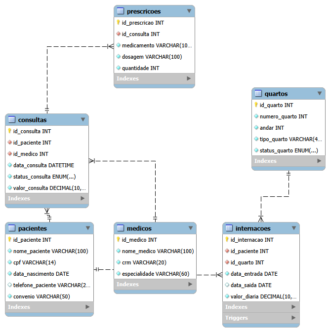

[readme_do_projeto_hospital_vida_sa_de.md](https://github.com/user-attachments/files/35029586/readme_do_projeto_hospital_vida_sa_de.md)
# 🏥 Sistema de Gestão Hospitalar — Vida & Saúde (`hospital_db`)

Projeto de modelagem, implementação e análise de dados relacional desenvolvido em **MySQL** para o gerenciamento operacional, clínico e financeiro de um ambiente hospitalar. O banco de dados **`hospital_db`** foi projetado para controlar o fluxo de pacientes, escalas e atendimentos médicos, ocupação de leitos, internações e prescrições de medicamentos.

---

## 📑 Sumário

1. [Estrutura do Repositório](#-estrutura-do-repositório)
2. [Modelo Entidade-Relacionamento (Diagrama EER)](#-modelo-entidade-relacionamento-diagrama-eer)
3. [Arquitetura e Dicionário de Dados](#-arquitetura-e-dicionário-de-dados)
4. [Regras de Negócio e Integridade (Constraints & Trigger)](#-regras-de-negócio-e-integridade-constraints--trigger)
5. [Consultas Estratégicas (DQL)](#-consultas-estrategicas-dql)
6. [Como Executar o Projeto](#-como-executar-o-projeto)
7. [Tecnologias Utilizadas](#-tecnologias-utilizadas)

---

## 📂 Estrutura do Repositório

| Arquivo | Categoria | Descrição |
| :--- | :---: | :--- |
| **`hospital.sql`** | `DDL` / `DML` | Script completo contendo a criação do banco `hospital_db`, definição das 6 tabelas, chaves primárias e estrangeiras, restrições (`CHECK`, `UNIQUE`), *trigger* de validação de leitos e carga inicial com 60 registros para testes (10 por tabela). |
| **`consultas_estrategicas.sql`** | `DQL` | Conjunto de **15 consultas SQL estratégicas** voltadas à tomada de decisão gerencial, utilizando junções (`INNER JOIN`, `LEFT JOIN`), agregações (`SUM`, `AVG`, `COUNT`), filtros (`WHERE`, `HAVING`, `BETWEEN`, `LIKE`) e subconsultas. |
| **`diagrama_hospital.png`** | `Diagrama` | Representação visual do Modelo Entidade-Relacionamento Estendido (EER) gerada via engenharia reversa no MySQL Workbench. |
| **`README.md`** | `Documentação` | Documentação técnica completa da arquitetura, dicionário de dados e instruções de execução do projeto. |

---

## 🗺️ Modelo Entidade-Relacionamento (Diagrama EER)

### Cardinalidade e Relacionamentos
* **`pacientes` (1) ➔ (N) `consultas`**: Um paciente pode realizar diversas consultas ao longo do tempo, mas cada consulta pertence a um único paciente.
* **`medicos` (1) ➔ (N) `consultas`**: Um médico atende várias consultas, enquanto cada consulta é conduzida por um médico específico.
* **`consultas` (1) ➔ (N) `prescricoes`**: Uma consulta médica pode gerar uma ou mais prescrições de medicamentos vinculadas diretamente àquele atendimento.
* **`pacientes` (1) ➔ (N) `internacoes`**: Um paciente pode possuir histórico de múltiplas internações hospitalares.
* **`quartos` (1) ➔ (N) `internacoes`**: Um quarto/leito recebe diversos pacientes em períodos distintos.

---

## 🗄️ Arquitetura e Dicionário de Dados

O modelo relacional foi normalizado até a **3ª Forma Normal (3FN)**, eliminando redundâncias, dependências parciais e dependências transitivas. Todas as tabelas utilizam a *engine* **`InnoDB`** e codificação **`utf8mb4`**.

### 1. Tabela `pacientes`
Armazena os dados cadastrais e de convênio dos pacientes atendidos pelo hospital.

| Coluna | Tipo de Dado | Restrições | Descrição |
| :--- | :--- | :--- | :--- |
| `id_paciente` | `INT` | `PK`, `AUTO_INCREMENT` | Identificador único do paciente. |
| `nome_paciente` | `VARCHAR(100)` | `NOT NULL` | Nome completo do paciente. |
| `cpf` | `VARCHAR(14)` | `NOT NULL`, `UNIQUE` | CPF formatado do paciente (evita cadastros duplicados). |
| `data_nascimento` | `DATE` | `NOT NULL` | Data de nascimento para cálculo de faixa etária. |
| `telefone_paciente` | `VARCHAR(20)` | `NULL` | Telefone de contato principal. |
| `convenio` | `VARCHAR(50)` | `NOT NULL`, `DEFAULT 'Particular'` | Plano de saúde do paciente ou atendimento particular. |

### 2. Tabela `medicos`
Registra os profissionais do corpo clínico e suas respectivas especialidades.

| Coluna | Tipo de Dado | Restrições | Descrição |
| :--- | :--- | :--- | :--- |
| `id_medico` | `INT` | `PK`, `AUTO_INCREMENT` | Identificador único do médico. |
| `nome_medico` | `VARCHAR(100)` | `NOT NULL` | Nome completo do profissional. |
| `crm` | `VARCHAR(20)` | `NOT NULL`, `UNIQUE` | Registro profissional no Conselho Regional de Medicina. |
| `especialidade` | `VARCHAR(60)` | `NOT NULL` | Área de atuação médica (ex.: Cardiologia, Ortopedia). |

### 3. Tabela `quartos`
Controla a estrutura física de acomodações, andares e disponibilidade operacional.

| Coluna | Tipo de Dado | Restrições | Descrição |
| :--- | :--- | :--- | :--- |
| `id_quarto` | `INT` | `PK`, `AUTO_INCREMENT` | Identificador único do quarto. |
| `numero_quarto` | `INT` | `NOT NULL`, `UNIQUE` | Numeração física do leito/quarto no hospital. |
| `andar` | `INT` | `NOT NULL` | Andar onde o quarto está localizado. |
| `tipo_quarto` | `VARCHAR(40)` | `NOT NULL` | Categoria da acomodação (UTI, Enfermaria, Apartamento, Suíte VIP). |
| `status_quarto` | `ENUM` | `NOT NULL`, `DEFAULT 'Livre'` | Situação atual: `'Livre'`, `'Ocupado'` ou `'Manutenção'`. |

### 4. Tabela `internacoes`
Gerencia o histórico e o faturamento de diárias das internações hospitalares.

| Coluna | Tipo de Dado | Restrições | Descrição |
| :--- | :--- | :--- | :--- |
| `id_internacao` | `INT` | `PK`, `AUTO_INCREMENT` | Identificador único da internação. |
| `id_paciente` | `INT` | `FK`, `NOT NULL` | Referência ao paciente internado (`pacientes.id_paciente`). |
| `id_quarto` | `INT` | `FK`, `NOT NULL` | Referência ao quarto ocupado (`quartos.id_quarto`). |
| `data_entrada` | `DATE` | `NOT NULL` | Data de admissão do paciente no leito. |
| `data_saida` | `DATE` | `NULL` | Data de alta hospitalar (`NULL` enquanto estiver internado). |
| `valor_diaria` | `DECIMAL(10, 2)` | `NOT NULL`, `CHECK (> 0)` | Custo unitário da diária da internação. |

### 5. Tabela `consultas`
Registra os agendamentos, atendimentos realizados e valores cobrados em consultas.

| Coluna | Tipo de Dado | Restrições | Descrição |
| :--- | :--- | :--- | :--- |
| `id_consulta` | `INT` | `PK`, `AUTO_INCREMENT` | Identificador único da consulta. |
| `id_paciente` | `INT` | `FK`, `NOT NULL` | Referência ao paciente (`pacientes.id_paciente`). |
| `id_medico` | `INT` | `FK`, `NOT NULL` | Referência ao médico (`medicos.id_medico`). |
| `data_consulta` | `DATETIME` | `NOT NULL` | Data e hora exata do atendimento. |
| `status_consulta` | `ENUM` | `NOT NULL`, `DEFAULT 'Agendada'` | Situação: `'Agendada'`, `'Realizada'` ou `'Cancelada'`. |
| `valor_consulta` | `DECIMAL(10, 2)` | `NOT NULL`, `CHECK (>= 0)` | Valor cobrado pelo atendimento médico. |

### 6. Tabela `prescricoes`
Detalha os medicamentos receitados ao paciente durante uma consulta.

| Coluna | Tipo de Dado | Restrições | Descrição |
| :--- | :--- | :--- | :--- |
| `id_prescricao` | `INT` | `PK`, `AUTO_INCREMENT` | Identificador único da prescrição. |
| `id_consulta` | `INT` | `FK`, `NOT NULL` | Referência à consulta de origem (`consultas.id_consulta`). |
| `medicamento` | `VARCHAR(100)` | `NOT NULL` | Nome e concentração do fármaco prescrito. |
| `dosagem` | `VARCHAR(100)` | `NOT NULL` | Posologia e intervalo de administração. |
| `quantidade` | `INT` | `NOT NULL`, `CHECK (> 0)` | Quantidade total de unidades prescritas. |

---

## 🛡️ Regras de Negócio e Integridade (`Constraints` & `Trigger`)

Para garantir a confiabilidade dos dados diretamente na camada do banco de dados, foram implementadas as seguintes proteções:

* **Integridade Referencial Estrita:** Todas as chaves estrangeiras utilizam `ON DELETE RESTRICT` e `ON UPDATE CASCADE`, impedindo a exclusão acidental de pacientes, médicos, quartos ou consultas que possuam registros vinculados.
* **Prevenção de Conflito de Agenda Médica (`uk_consultas_medico_horario`):** Restrição `UNIQUE (id_medico, data_consulta)` que impede o agendamento de dois pacientes para o mesmo médico no mesmo horário.
* **Validação Cronológica e Financeira (`CHECK`):**
  * `chk_internacoes_datas`: Garante que `data_saida` seja maior ou igual a `data_entrada`.
  * `chk_internacoes_diaria` e `chk_prescricoes_qtd`: Exigem valores estritamente maiores que zero (`> 0`).
* **Trigger Anti-Sobreposição de Leitos (`trg_bloqueia_sobreposicao_leito`):**
  * Gatilho `BEFORE INSERT ON internacoes` que verifica se o quarto escolhido já possui alguma internação ativa ou conflitante no intervalo de datas informado. Caso haja choque de datas, a inserção é bloqueada com erro personalizado (`SQLSTATE '45000'`).

---

## 📊 Consultas Estratégicas (`DQL`)

O arquivo **`consultas_estrategicas.sql`** contém **15 consultas** estruturadas para responder a perguntas operacionais e gerenciais da administração hospitalar:

1. **Listagem Geral de Pacientes:** Consulta ordenada alfabeticamente com dados de contato e convênio.
2. **Mapeamento do Corpo Clínico:** Filtro de médicos por especialidades estratégicas (Cardiologia e Cirurgias).
3. **Disponibilidade de Leitos:** Identificação de quartos livres e ocupados por andar e categoria.
4. **Histórico Detalhado de Consultas:** Cruzamento (`INNER JOIN`) entre pacientes, médicos, especialidades e status do atendimento.
5. **Relatório de Internações e Custos:** Cálculo do tempo de permanência (`DATEDIFF`) e valor total das internações por paciente.
6. **Receita por Convênio Médico:** Agrupamento (`GROUP BY`) e soma (`SUM`) do faturamento gerado por plano de saúde.
7. **Produtividade do Corpo Clínico:** Contagem de atendimentos realizados e ticket médio (`AVG`) por médico.
8. **Receita por Especialidade Médica:** Ranking das especialidades com maior volume de arrecadação em consultas.
9. **Auditoria de Prescrições Médicas:** Relação completa de medicamentos receitados vinculando paciente, médico e data da consulta.
10. **Medicamentos Mais Prescritos:** Ranking dos fármacos com maior demanda na farmácia hospitalar.
11. **Ocupação e Faturamento por Andar:** Análise financeira das diárias agrupadas por pavimento do hospital.
12. **Pacientes Recorrentes:** Filtro com `HAVING` para identificar pacientes com múltiplas consultas ou internações.
13. **Análise de Convênios Específicos:** Filtro com operador `LIKE` para consolidar investimentos de planos da rede Unimed.
14. **Consultas de Alto Valor (Acima da Média):** Uso de subconsulta (*Subquery*) para listar atendimentos superiores à média geral do hospital.
15. **Médicos sem Atendimentos Registrados:** Uso de `LEFT JOIN` para identificar profissionais disponíveis na escala sem consultas vinculadas.

---

## 🚀 Como Executar o Projeto

1. **Pré-requisitos:** Tenha o **MySQL Server (8.0+)** e o **MySQL Workbench** instalados na sua máquina.
2. **Criar e Popular o Banco de Dados:**
   * Abra o arquivo **`hospital.sql`** no MySQL Workbench.
   * Execute todo o script (ícone de raio ⚡ ou `Ctrl + Shift + Enter`).
   * Atualize o painel *Schemas* para visualizar o banco **`hospital_db`** com suas 6 tabelas populadas e a *trigger* ativa.
3. **Executar as Análises:**
   * Abra o arquivo **`consultas_estrategicas.sql`** em uma nova aba de consulta.
   * Execute os comandos individualmente ou em bloco para visualizar os resultados das 15 perguntas de negócio.

---

## 🛠️ Tecnologias Utilizadas

* **SGBD:** MySQL 8.0+
* **Ferramenta de Modelagem e Administração:** MySQL Workbench
* **Linguagem:** SQL (`DDL`, `DML`, `DQL`, `Triggers` e `Constraints`)
